# WAVVE — Plateforme Web de Streaming Musical & Gestion de Playlists

<p align="center">
  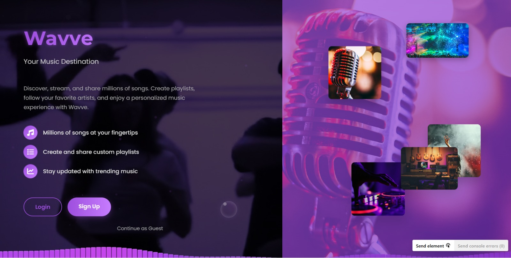
</p>

<p align="center">
  
  
  
  
  
  
  
</p>

---

## 📑 Présentation du Projet

**WAVVE** est une application web moderne et responsive dédiée à l'écoute, la découverte et la gestion musicale en continu. L'application offre une expérience utilisateur fluide et immersive, s'inspirant des plateformes de streaming contemporaines tout en intégrant une architecture logicielle robuste.

L'application exploite l'**API Deezer** pour son catalogue mondial (millions de morceaux, artistes, albums et extraits audio), complétée par un **backend proxy Flask** contournant les restrictions de cross-origin (CORS) sans nécessiter de clé API côté client.

---


## 📸 Galerie & Interfaces Utilisateur

### 1. Page d'Accueil & Présentation
Porte d'entrée interactive de la plateforme avec animations dynamiques, mise en avant des fonctionnalités clés et accès rapide à la découverte musicale.
<p align="center">
  
</p>

### 2. Interface de Streaming & Lecteur Audio
Interface principale de navigation offrant un lecteur audio complet (lecture/pause, piste suivante/précédente, barre de progression dynamique, contrôle de volume et affichage des métadonnées).
<p align="center">
  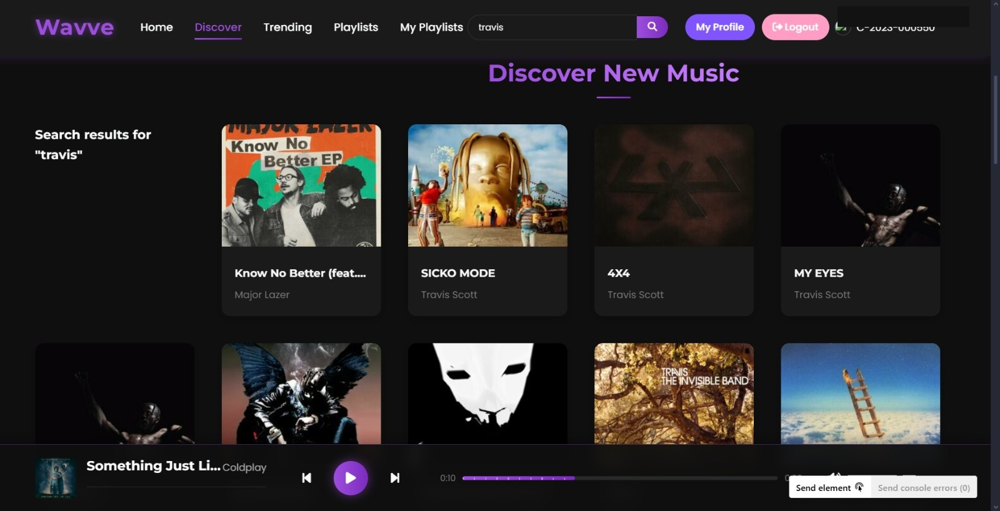
</p>

### 3. Moteur de Recherche & Catalogue Deezer
Recherche instantanée d'artistes, morceaux et albums avec prévisualisation des jaquettes et lancement immédiat des flux audio.
<p align="center">
  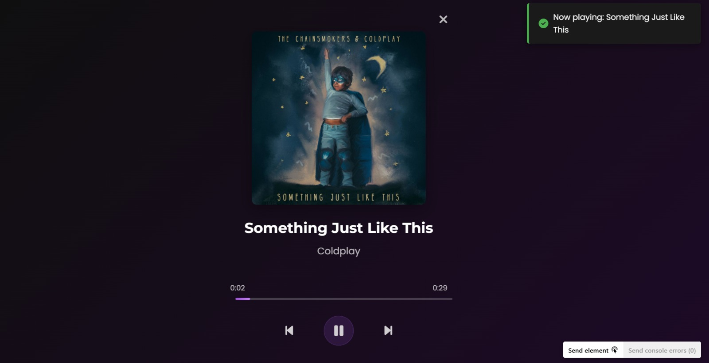
</p>

### 4. Création & Gestion des Playlists
Création de listes de lecture personnalisées, organisation des morceaux favoris et gestion intuitive depuis un modal dédié.
<p align="center">
  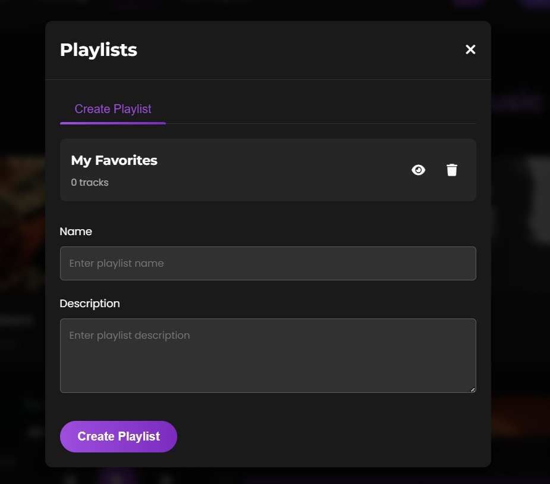
</p>

### 5. Espace & Profil Utilisateur
Personnalisation du profil avec avatar dynamique, bannière d'en-tête, sélection de genres favoris et paramètres de sécurité.
<p align="center">
  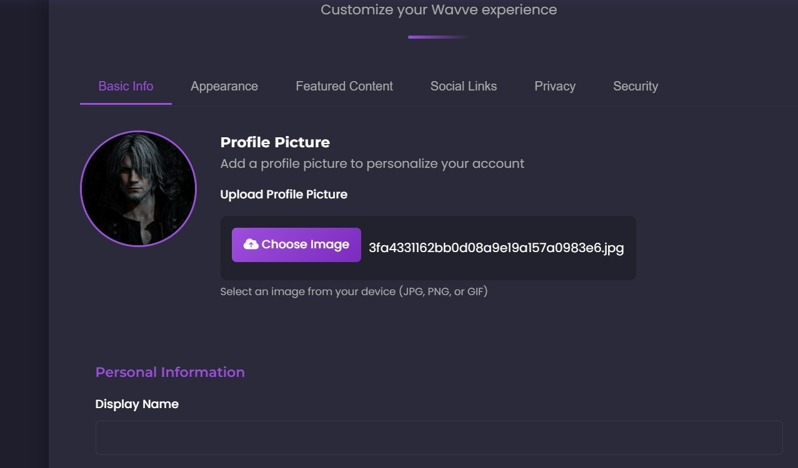
</p>

### 6. Authentification & Sécurité
Système d'inscription et de gestion des accès avec validation des identifiants, hachage sécurisé des mots de passe (Werkzeug / PBKDF2) et sessions `Flask-Login`.
<p align="center">
  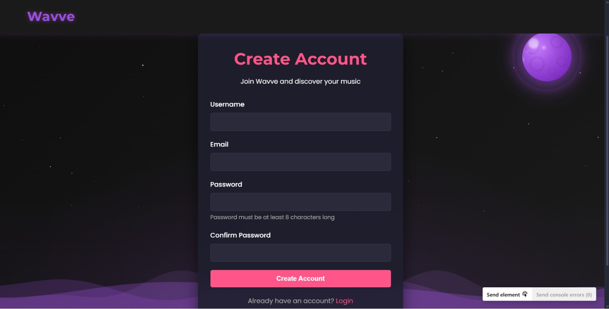
</p>

---

## ⚙️ Fonctionnalités Principales

- 🎵 **Exploration & Streaming en Direct :** Navigation dans les tendances mondiales, écoute des extraits officiels Deezer en haute qualité.
- 🔍 **Moteur de Recherche Multicritère :** Filtrage instantané par titre de chanson, nom d'artiste ou album.
- 🎛️ **Lecteur Audio Intégré :** Contrôles interactifs complets, suivi de lecture en temps réel, mise en mémoire tampon optimisée.
- 📋 **Gestionnaire de Playlists :** Création, modification et suppression de playlists privées et ajout dynamique de morceaux.
- 👤 **Gestion des Profils & Personnalisation :** Téléversement d'avatars et de bannières personnalisées, bio, localisation et genres favoris.
- 🛡️ **Sécurité & Sessions :** Authentification robuste avec `Flask-Login`, protection CSRF et hachage cryptographique sécurisé des mots de passe.
- 🔄 **Proxy API Backend :** Relais serveur Python évitant les blocages CORS et assurant la normalisation des réponses JSON.

---

## 📐 Conception & Modélisation UML

Le projet suit une démarche d'ingénierie logicielle basée sur le **Cycle en V** et la modélisation standard **UML** :

### 1. Cycle de Développement en V
<p align="center">
  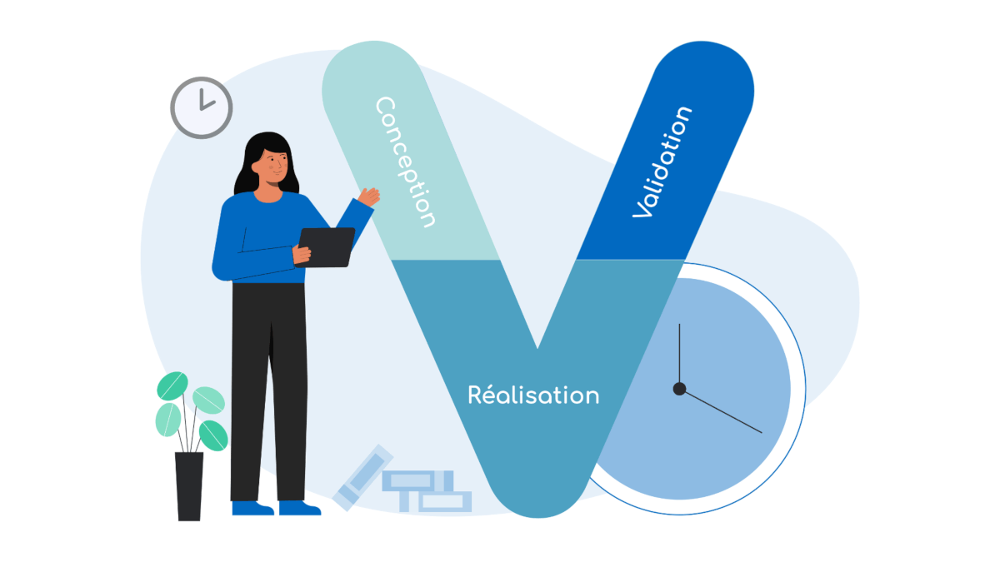
</p>

### 2. Diagramme Global des Cas d'Utilisation
<p align="center">
  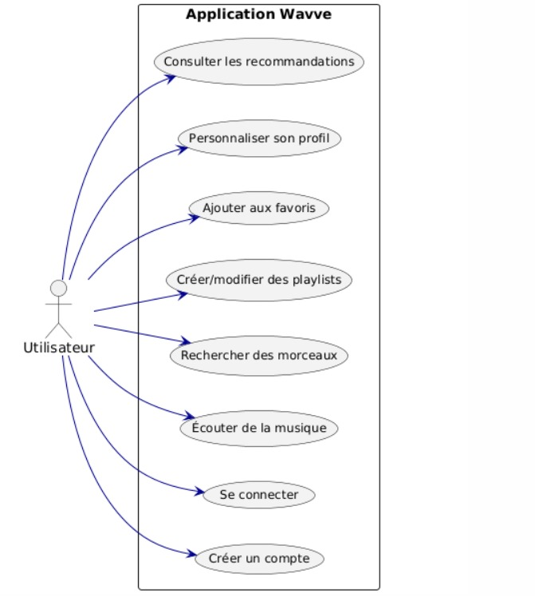
</p>

### 3. Diagrammes de Séquences
| Connexion Utilisateur | Lancement de Lecture Audio | Création de Playlist |
|:---:|:---:|:---:|
| 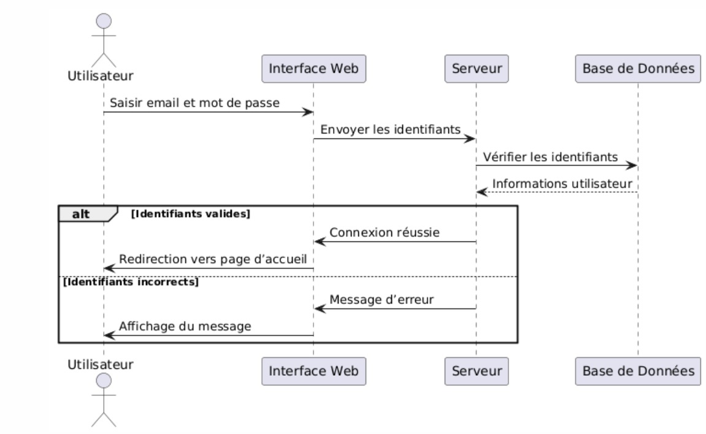 | 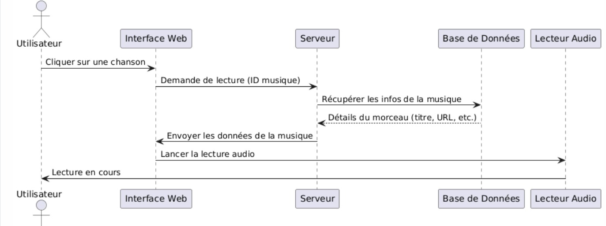 | 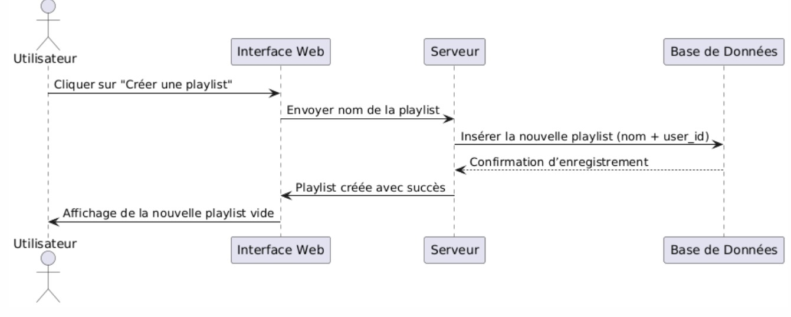 |

### 4. Diagramme de Classes & Modèle Relationnel
| Diagramme de Classes UML | Modèle Relationnel (Base de Données) |
|:---:|:---:|
| 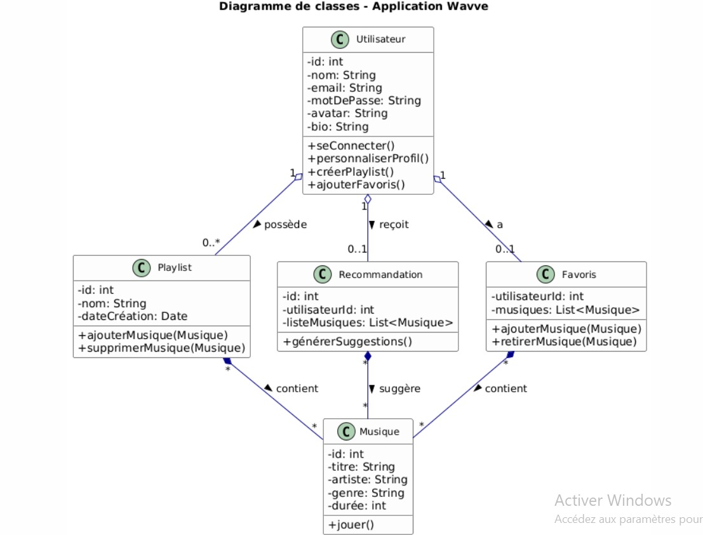 | 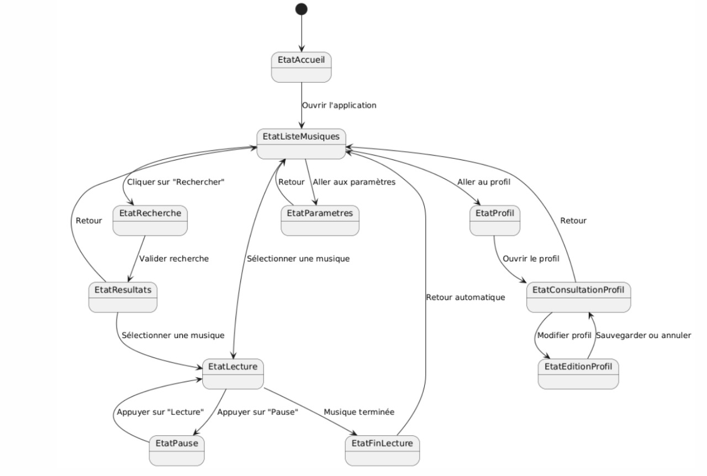 |

### 5. Architectures Système & Réseau
| Architecture Logicielle | Architecture Matérielle & Flux |
|:---:|:---:|
| 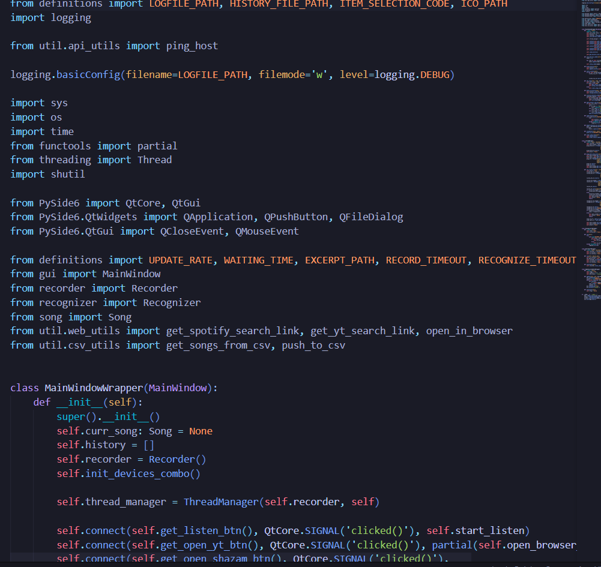 | 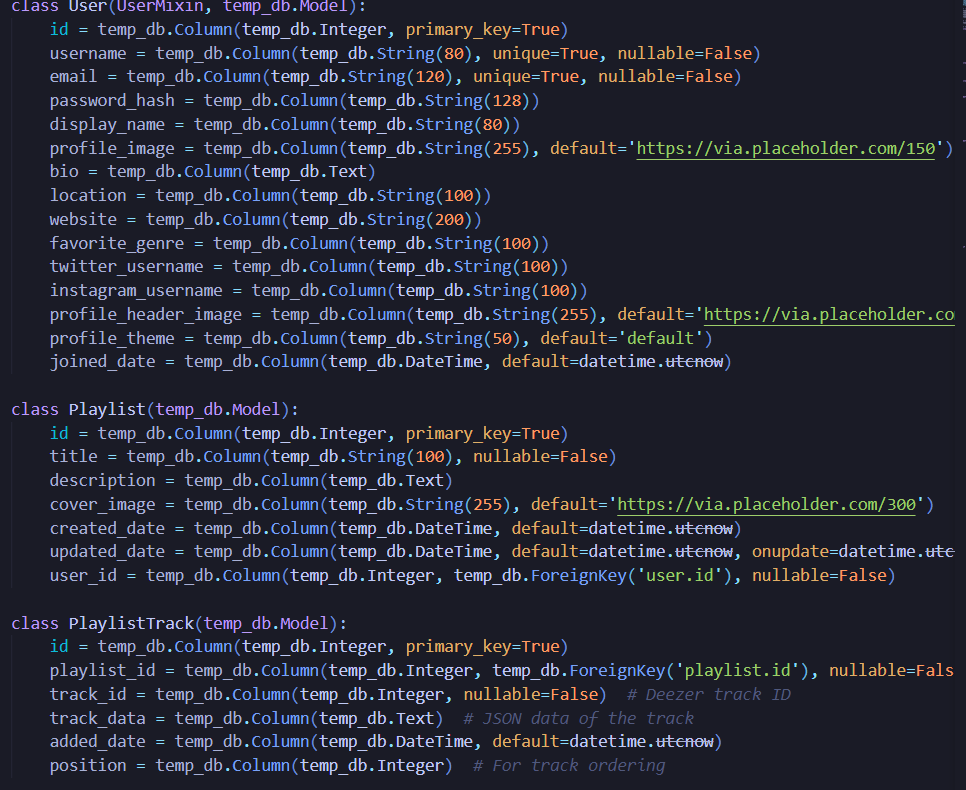 |

---

## 🛠️ Stack Technologique

- **Backend :** Python 3, Flask 2.3.3, Flask-SQLAlchemy 3.1.1, Flask-Login 0.6.3, Flask-WTF, Werkzeug.
- **Frontend :** HTML5, CSS3 (Flexbox/Grid, variables CSS, animations), Vanilla JavaScript (ES6+), FontAwesome, Google Fonts (Poppins / Montserrat).
- **Base de Données :** SQLite via ORM SQLAlchemy (compatibilité directe MySQL / PostgreSQL).
- **Serveur WSGI Production :** Waitress 2.1.2.
- **API Externe :** Deezer Music REST API.
- **Modélisation :** StarUML.

---

## 🚀 Installation & Démarrage

### Prérequis
- **Python 3.9+** installé sur votre machine ([python.org](https://www.python.org/downloads/)).
- **Git** pour cloner le dépôt.

### Option A — Lancement Rapide (Windows)
Double-cliquez simplement sur le script automatisé :
```cmd
start_wavve_app.bat
```
Ce script installe les dépendances nécessaires, initialise la base de données et ouvre automatiquement l'application dans votre navigateur par défaut à l'adresse `http://localhost:5000`.

### Option B — Installation Manuelle

1. **Cloner le projet :**
   ```bash
   git clone https://github.com/LibrarianPoms/PFA-Project-Music-App-G3.git
   cd PFA-Project-Music-App-G3
   ```

2. **Créer et activer un environnement virtuel (recommandé) :**
   ```bash
   python -m venv venv
   # Sous Windows :
   venv\Scripts\activate
   # Sous Linux / macOS :
   source venv/bin/activate
   ```

3. **Installer les dépendances :**
   ```bash
   pip install -r requirements.txt
   ```

4. **Lancer le serveur :**
   ```bash
   python server.py
   ```

5. **Accéder à l'application :**
   Ouvrez votre navigateur sur : [http://localhost:5000](http://localhost:5000)

---

## 📁 Structure du Répertoire

```text
PFA-Project-Music-App-G3/
│
├── auth/                         # Modules d'authentification et scripts clients
│   ├── auth.js                   # Gestionnaire client des formulaires d'authentification
│   ├── playlist-manager.js       # Gestion des requêtes de playlists utilisateur
│   ├── profile-features.js       # Gestion dynamique des paramètres de profil
│   └── templates/                # Gabarits HTML d'authentification
│       ├── edit_profile.html
│       ├── login.html
│       ├── profile.html
│       └── register.html
│
├── playlists/                    # Modules et styles spécifiques aux playlists
│   ├── playlistManager.js        # Logique d'ajout, suppression et tri de titres
│   └── playlistStyles.css        # Styles dédiés aux vues de playlists
│
├── static/                       # Fichiers statiques publics
│   ├── icons/                    # Icônes vectorielles et assets
│   ├── images/                   # Logos et illustrations de l'application
│   └── uploads/                  # Répertoire de stockage des uploads utilisateurs
│       ├── header_images/        # Bannières de profil
│       └── profile_images/       # Avatars de profil
│
├── templates/                    # Gabarits Jinja2 Flask
│   ├── auth/                     # Vues d'authentification et profils
│   └── landing.html              # Vue d'accueil de l'application
│
├── docs/                         # Documentation visuelle et schémas
│   └── screenshots/              # Captures d'écran de l'application et diagrammes UML
│
├── app.js                        # Contrôleur JavaScript principal (Lecteur audio & Deezer API)
├── hero-animations.js            # Moteur d'animations de la page d'accueil
├── index.html                    # Interface principale du lecteur de streaming
├── player-animations.css         # Animations CSS du visualiseur et du lecteur
├── styles.css                    # Feuilles de styles principales de l'application
├── server.py                     # Serveur Flask principal (Routes, Proxy Deezer & ORM)
├── requirements.txt              # Dépendances Python du projet
├── start_server.bat              # Script de démarrage du serveur
├── start_wavve_app.bat           # Script de lancement tout-en-un
├── .gitignore                    # Exclusion des caches, bases de données et temporaires
└── README.md                     # Documentation officielle du projet
```
